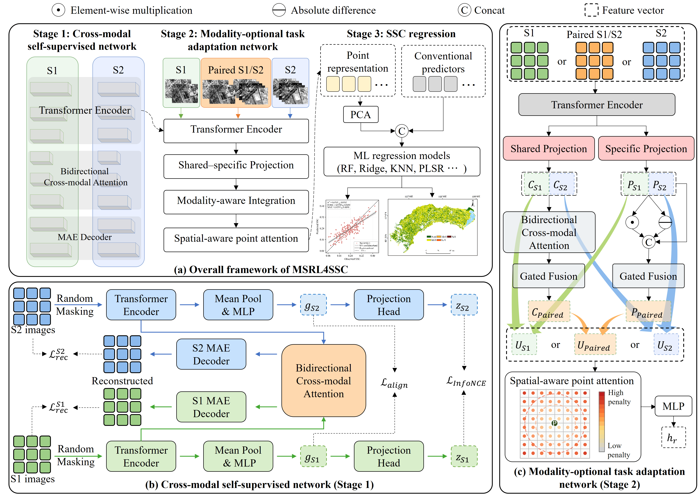

# MSRL4SSC
<p align="center">
  
</p>

## Project structure

```text
MSRL4SSC/
├── assets/
│   ├── Framework.png
│   ├── Classifiedmapping2022.tif   
│   └── Classifiedmapping2023.tif   
├── data/
│   ├── input_patches/   
│   ├── large_raster/                 
│   └── samples/  
├── pretrained/                             
├── model.py                                
├── train.py                             
├── predict_large_raster.py                
├── requirements.txt
└── README.md
```

## Installation

```bash
conda create -n msrl4ssc python=3.10 -y
conda activate msrl4ssc
pip install -r requirements.txt
```

## Input data
Sentinel-1 and Sentinel-2 imagery, DEM, soil clay content, sand content, and bulk density at a depth of 30 cm. 
This repository provides only a small demonstration dataset to illustrate the required input structure and workflow.

### GeoTIFFs

Each multiband GeoTIFF must have unique band descriptions. Paired inference requires the following bands:

```text
SI3, S_2, S_5, kNDMI, TCARI, VV, VH,
DEM, Soil_Clay, Soil_Sand, Pb_030
```

### SSC sample table

The training table is a CSV file with one row per field observation. Required columns are:

| Column | Description |
|:--|:--|
| `raster_path` | Absolute path, or a path relative to the CSV file, to the matching GeoTIFF |
| `SSC` | Measured soil salt content |
| `row`, `col` | Raster pixel coordinates of the sample |

Instead of `row` and `col`, the table may contain map coordinates in `x` and `y`. An optional `fold` column can provide predeclared spatial-fold assignments. 
Example:

```csv
Sample_ID,raster_path,x,y,SSC,fold
P001,geotiff/tile_01.tif,501235.0,4506780.0,0.084,1
P002,geotiff/tile_02.tif,503420.0,4505210.0,0.116,2
```

## Training

The following command runs all three stages, performs spatial-fold evaluation, and fits deployable S1, S2, and paired S1/S2 models on all samples:

```bash
python train.py \
  --samples /path/to/sample_index.csv \
  --output-dir outputs/training \
  --device cuda
```

## Large-raster inference

After training, the GeoTIFFs in `data/large_raster/`. The default command is:

```bash
python predict_large_raster.py --invalid-values -9999 -32768 -999
```

The default locations are `outputs/training` for the fitted model,
`data/large_raster` for input rasters, and `outputs/prediction_maps` for
outputs. The default `--path auto` checks the centre pixel of every inference
cell against finite-value and GeoTIFF nodata masks. It uses the paired path when
S1 and S2 are both valid, the corresponding single-modality path when only S1
or S2 is valid. 

## Reported results

On the 2023 Hetao Irrigation District dataset, the manuscript reports:

| Available modality | \(R^2\) |
|:--|--:|
| Sentinel-1 | 0.3054 |
| Sentinel-2 | 0.6748 |
| Sentinel-1 and Sentinel-2 | 0.6917 |

<p align="center">
  
</p>

<p align="center">
  
</p>

## Acknowledgements

MSRL4SSC builds on radar-optical representation learning in CROMA and on shared-specific feature modelling for incomplete multimodal learning.
We sincerely thank the authors and open-source communities of the following studies for their valuable contributions and publicly available research resources.

```bibtex
@inproceedings{Fuller2023CROMA,
  author    = {Fuller, Anthony and Millard, Koreen and Green, James},
  title     = {{CROMA}: Remote Sensing Representations with Contrastive Radar-Optical Masked Autoencoders},
  booktitle = {Advances in Neural Information Processing Systems},
  volume    = {36},
  pages     = {5506--5538},
  year      = {2023},
  doi       = {10.52202/075280-0241}
}

@inproceedings{Wang2023MultiModal,
  author    = {Wang, Hu and Chen, Yuanhong and Ma, Congbo and Avery, Jodie and Hull, Louise and Carneiro, Gustavo},
  title     = {Multi-modal Learning with Missing Modality via Shared-Specific Feature Modelling},
  booktitle = {Proceedings of the IEEE/CVF Conference on Computer Vision and Pattern Recognition},
  pages     = {15878--15887},
  year      = {2023},
  doi       = {10.1109/CVPR52729.2023.01524}
}
```

<!-- ## Citation and license -->
